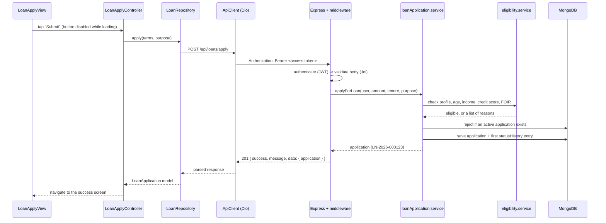

# Credit Sea — Loan Application App

A loan application product built as a monorepo: a **Flutter** mobile app and a
**Node.js / Express / MongoDB** backend. A user signs in with a mobile number and
OTP, completes a profile, calculates an EMI, checks eligibility, applies for a
loan, tracks its status and pays installments, which moves their credit score.

There is no mock data: the app talks to the real backend for everything.

| Part      | Folder                  | Docs                                |
| --------- | ----------------------- | ----------------------------------- |
| Mobile    | [`mobile/`](mobile)     | [mobile/README.md](mobile/README.md) |
| Backend   | [`backend/`](backend)   | [backend/README.md](backend/README.md) |
| API calls | `backend/docs/`         | Postman collection                  |
| UI design | [`design/`](design)     | [design/README.md](design/README.md) |

## What it does

1. **Login:** mobile number + OTP. The session lasts until the user logs out.
2. **Profile:** name, DOB, gender, PAN, email, income, employment type, city.
3. **Loan calculator:** amount and tenure give the EMI, total interest and total
   payable, calculated by the backend.
4. **Eligibility and apply:** the server checks the stored profile and credit
   score, returns plain-language reasons when it says no, and blocks a second
   active application.
5. **Status tracking:** `submitted -> under_review -> approved / rejected ->
   disbursed`, shown as a timeline.
6. **Repayments and credit score:** a disbursed loan gets a repayment schedule.
   Paying on time raises the credit score; paying late lowers it.

Push notifications are **not part of this build** (see
[Not included](#not-included)).

## Tech stack

| Layer    | Choice                                                                     |
| -------- | -------------------------------------------------------------------------- |
| Mobile   | Flutter, GetX (state, DI, routing), Dio, flutter_secure_storage, intl      |
| Backend  | Node.js 18+, Express, Mongoose, Joi, JSON Web Tokens, bcryptjs             |
| Security | helmet, CORS, express-rate-limit, hashed OTPs, hashed refresh tokens       |
| Database | MongoDB (local or Atlas)                                                   |
| Tests    | Jest + Supertest (backend), `flutter_test` (mobile)                        |

## Architecture

```
┌──────────────────────── Flutter app ─────────────────────────┐
│  View (widgets)  ──►  Controller (GetX)  ──►  Repository      │
│  no logic            screen state            maps JSON ⇄ models│
│                                                  │             │
│                                         ApiClient (Dio)        │
│                          adds token · refreshes on 401 · errors│
└──────────────────────────────────┬───────────────────────────┘
                                   │ HTTPS/JSON  { success, message, data }
┌──────────────────────────────────▼───────────────────────────┐
│                       Express API (/api)                      │
│  Route ─► Middleware ─► Controller ─► Service ─► Model        │
│           auth, Joi     HTTP only     business    Mongoose    │
│           rate limit                  rules                   │
│                                         │                     │
│                                  loanEvents (EventEmitter)    │
└──────────────────────────────────┬───────────────────────────┘
                                   │
                              ┌────▼────┐
                              │ MongoDB │
                              └─────────┘
```

Both sides follow the same rule: **each layer does one job and only talks to
the layer next to it.** Business rules live in backend services; widgets never
call the API; controllers never touch HTTP details.

## Folder structure

```
loan_calc/
├── backend/
│   ├── src/
│   │   ├── config/        env validation, MongoDB connection
│   │   ├── constants/     loan, repayment and credit-score rules, HTTP codes
│   │   ├── routes/        URL -> middleware -> controller
│   │   ├── controllers/   request/response only
│   │   ├── services/      business logic (auth, OTP, EMI, eligibility, ...)
│   │   ├── models/        Mongoose schemas
│   │   ├── middlewares/   auth, admin key, validation, rate limit, errors
│   │   ├── validators/    Joi schemas
│   │   ├── events/        loan status event bus
│   │   └── utils/         tokens, phone, PAN, dates, AppError
│   ├── tests/             Jest + Supertest
│   ├── scripts/           simulateLoan.js (demo helper)
│   └── docs/              Postman collection
├── mobile/
│   ├── lib/
│   │   ├── core/          config, theme, network, storage, shared widgets
│   │   ├── data/          models, repositories
│   │   ├── modules/       one folder per screen: controller + binding + view
│   │   └── routes/        route names and pages
│   └── test/
└── design/                Figma exports and design tokens
```

## One request, end to end: "Apply for a loan"



If the access token has expired the API answers `401`. `ApiClient` then calls
`/auth/refresh` once, stores the new token pair and replays the request. The
controller never sees it. If the refresh also fails, the session is cleared and
the user is sent to the login screen.

Every error leaves the server in one shape, `{ success: false, message,
errors? }`, and `ApiException` turns it (or a network failure) into a message
the screen can show.

## Quick start

You need Node 18+, Flutter 3.47+ and a MongoDB (local or Atlas).

```bash
# 1. Backend
cd backend
npm install
cp .env.example .env        # set MONGO_URI and the secrets
npm run dev                 # http://localhost:5000

# 2. Mobile (another terminal)
cd mobile
flutter pub get
flutter run                 # Android emulator reaches the backend automatically
```

With `OTP_MODE=demo` (the default in `.env.example`) every OTP is `123456`.
Details, env vars and real-device setup are in the two READMEs.

## Run the tests

```bash
cd backend && npm test                 # needs MongoDB; see backend/README.md
cd mobile  && flutter analyze && flutter test
```

## How to explain this project

Eight decisions that shape the code, and why. Each is something you can point
at in the repo.

1. **Strict layering.** Backend: route -> controller -> service -> model.
   Mobile: repository -> controller -> view. Rules live in one layer, so a
   change (say, a new eligibility rule) touches one file and is testable without
   HTTP or UI. *See* `backend/src/services/eligibility.service.js`.

2. **Eligibility is decided on the server.** The app shows the result but can't
   change it. `apply` re-runs the same check against the stored profile, so a
   modified client or a stale screen can't get a loan through. The server
   returns readable `reasons`, so the app doesn't need to know the rules.

3. **Tokens: short access + rotating refresh.** The access token lives 15
   minutes; the refresh token lives 7 days, is stored hashed on the user, and is
   replaced on every refresh, so a stolen old one stops working. In the app a
   single shared refresh is in flight at a time and the failed request is
   replayed once. *See* `mobile/lib/core/network/api_client.dart`.

4. **Loan status is a state machine.** One map in `loanWorkflow.service.js`
   lists the only legal moves. Admin API, simulator and auto-decision all go
   through the same function, so an illegal jump (e.g. `submitted ->
   disbursed`) is a `409` everywhere, and every move is recorded in
   `statusHistory`, which is what the timeline renders.

5. **Event-driven side effects.** A status change emits `loan.status.changed`;
   the workflow doesn't know who listens. Today nothing subscribes because push
   notifications aren't built; a notifier can be added as a listener without
   editing the workflow. *See* `backend/src/events/loanEvents.js`.

6. **OTP delivery behind an interface.** `auth.service` calls an `OtpSender`.
   `demo`, `console` and `sms` are interchangeable via `OTP_MODE`. Hashing,
   expiry, attempt limits and rate limiting are identical in every mode.
   `demo` is refused when `NODE_ENV=production`.

7. **Rules are constants, not scattered numbers.** Loan limits, the 12% rate,
   eligibility thresholds, credit-score changes and bands each live in one
   constants file, so the calculator, eligibility and request validation can't
   disagree, and the rules are easy to audit. *See*
   `backend/src/constants/`.

8. **GetX controllers own screen state.** Each screen has a controller (state
   and actions), a binding (builds its dependencies) and a view (just
   renders). Views only read observables, controllers never import widgets, and
   controllers are tested with fake repositories.

## Not included

- **Push notifications (FCM):** deliberately not built. The backend already
  emits `loan.status.changed` and the `User` model reserves an `fcmTokens`
  field, and the app has a placeholder `/notifications` route, but nothing is
  wired to Firebase.
- **Real SMS delivery:** `OTP_MODE=sms` is a stub to implement per provider.
- **Admin accounts:** the admin API uses one shared `ADMIN_API_KEY`. Replace it
  with real admin users and roles before launch.
- **Payments:** installment payments are simulated; there is no gateway.
