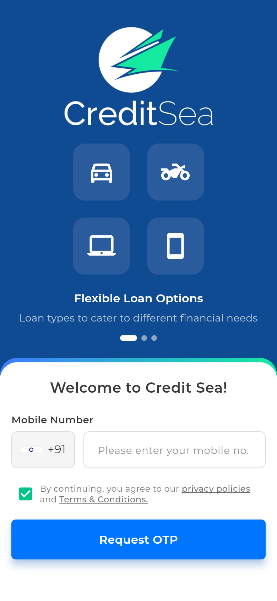
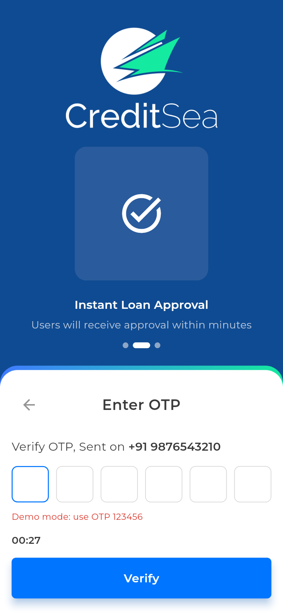
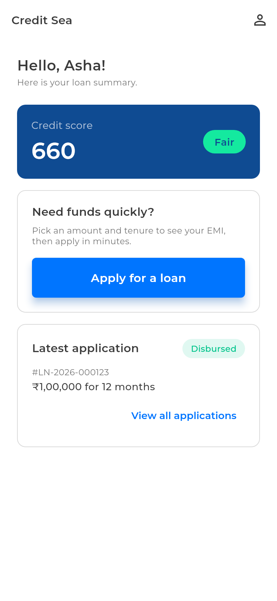
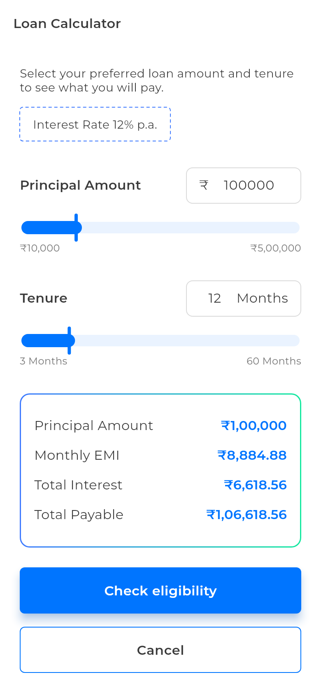
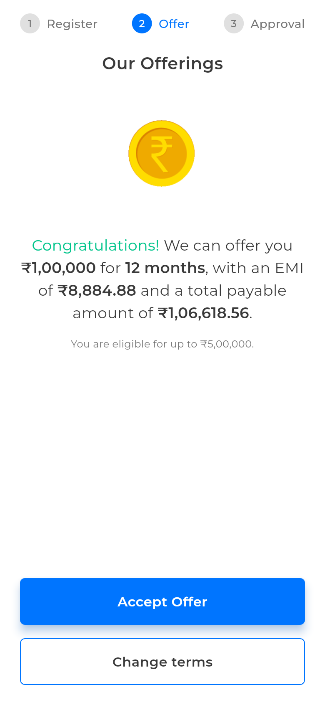
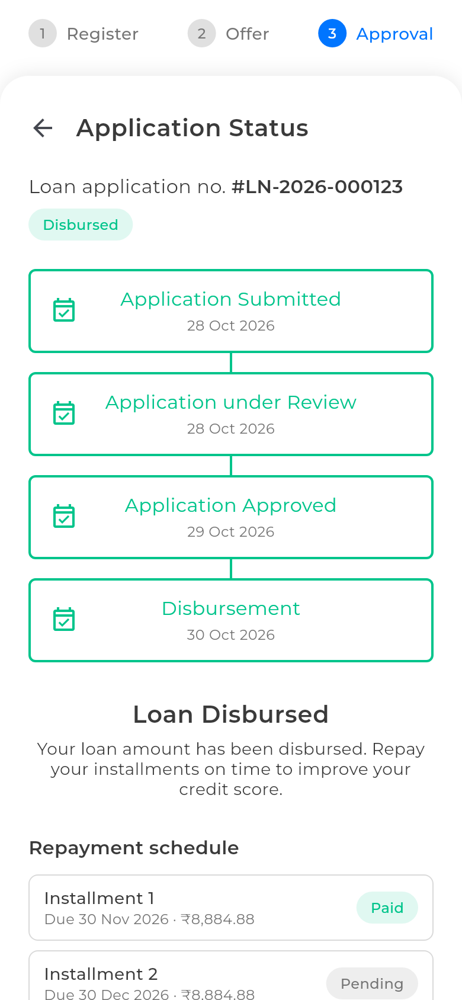
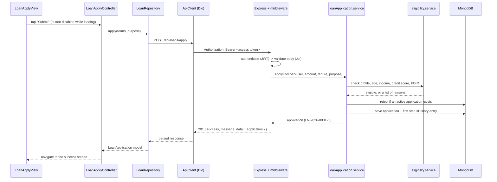
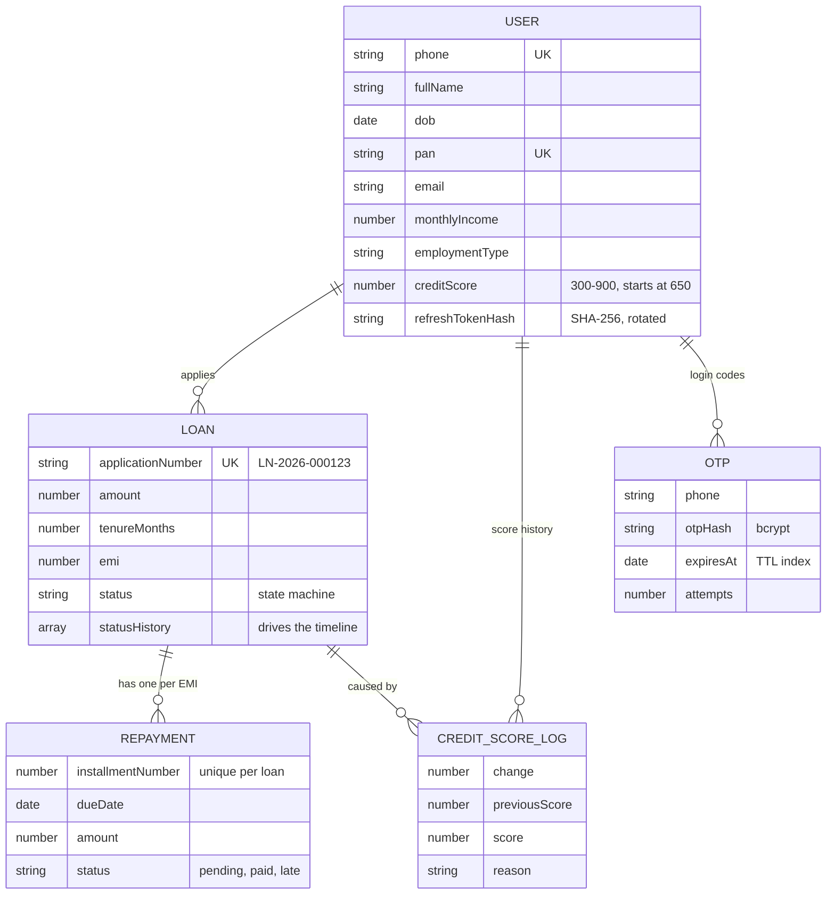

# Credit Sea — Loan Application App

A complete loan journey on a phone: sign in with a mobile number, build a
profile, calculate an EMI, check eligibility, apply, track the application, and
repay the loan while a credit score reacts to every payment.

Built as a monorepo with a **Flutter** app and a **Node.js / Express / MongoDB**
API. The app talks to the real backend for everything; there is no mock data.


## Contents

- [Screenshots](#screenshots)
- [Highlights](#highlights)
- [Requirement coverage](#requirement-coverage)
- [Try it in 5 minutes](#try-it-in-5-minutes)
- [Architecture](#architecture)
- [How one request flows](#how-one-request-flows-apply-for-a-loan)
- [Data model](#data-model)
- [Business rules at a glance](#business-rules-at-a-glance)
- [API overview](#api-overview)
- [Security](#security)
- [Testing and verification](#testing-and-verification)
- [Project structure](#project-structure)
- [Configuration](#configuration)
- [Deploy on Render](#deploy-on-render)
- [Troubleshooting](#troubleshooting)
- [Limitations and future work](#limitations-and-future-work)
- [Documentation index](#documentation-index)

## Screenshots

<table>
  <tr>
    <td align="center"><br><sub><b>Mobile number</b></sub></td>
    <td align="center"><br><sub><b>OTP (demo hint)</b></sub></td>
    <td align="center"><br><sub><b>Home and credit score</b></sub></td>
  </tr>
  <tr>
    <td align="center"><br><sub><b>Loan calculator</b></sub></td>
    <td align="center"><br><sub><b>Eligible offer</b></sub></td>
    <td align="center"><br><sub><b>Status timeline and repayments</b></sub></td>
  </tr>
</table>

These are the app's own screens, rendered by `mobile/tool/screenshots_test.dart`
with sample data (a fictional user), so they can be regenerated at any time:

```bash
cd mobile && flutter test tool/screenshots_test.dart --update-goldens
```

The Figma frames the UI follows are in [`design/screens`](design/screens).

## Highlights

- **Server-side decisions.** Eligibility, EMI and status rules live on the
  backend. The app displays results and cannot change them.
- **Readable "no".** An ineligible user gets plain-language reasons ("EMI is
  more than 50% of your income. Try a smaller amount or a longer tenure.").
- **Safe sessions.** Short-lived access tokens, rotating hashed refresh tokens,
  one shared refresh when several requests fail at once, secure on-device
  storage, and a session that survives app restarts.
- **A real state machine.** Loan status moves only along allowed paths and
  every move is recorded, which is what the timeline renders.
- **Credit score that means something.** On-time repayment raises it, late
  payment lowers it, and every change is written to an audit log.
- **Built to be explained.** Strict layering on both sides, rules in constants,
  small functions, and a [design-decisions guide](docs/design-decisions.md).
- **Tested.** 149 backend tests, 76 mobile tests, a clean `flutter analyze`,
  and a 44-check end-to-end run against the live API (see
  [verification](#testing-and-verification)).

## Requirement coverage

| Requirement                                              | Status | Where                                                                 |
| -------------------------------------------------------- | ------ | --------------------------------------------------------------------- |
| Mobile number login with OTP                             | Done   | `auth.service.js`, `modules/auth`, `modules/otp`                      |
| Stay logged in until manual logout                       | Done   | `SessionService`, secure token storage, refresh-token rotation        |
| Profile (name, DOB, gender, PAN, email, income, type)    | Done   | `user.service.js`, 4-step `modules/profile_setup`                     |
| Loan calculator (amount, tenure, EMI)                    | Done   | `loanCalculator.service.js`, `modules/loan_calculator`                |
| Eligibility from user details                            | Done   | `eligibility.service.js`, `modules/loan_eligibility`                  |
| Loan application saved in the backend                    | Done   | `loanApplication.service.js`, `modules/loan_apply`                    |
| Status tracking: Submitted, Under Review, Approved or Rejected, Disbursed | Done | `loanWorkflow.service.js`, `modules/loan_status`            |
| Approval logic                                           | Done   | admin `auto-decision` endpoint                                        |
| Basic credit score (repayments raise it)                 | Done   | `creditScore.service.js`, `repayment.service.js`                      |
| Flutter and backend fully integrated, no mock data       | Done   | `data/repositories` call the live API                                 |
| Push notifications (FCM)                                 | Not built | The backend emits `loan.status.changed`; nothing is wired to Firebase |

## Try it in 5 minutes

You need Flutter 3.47+. The backend is already deployed; Node 18+ and a MongoDB
are only needed if you want to run your own copy.

**1. Backend: nothing to start**

The app is wired to the deployed API at
[`https://credit-sea-api.onrender.com`](https://credit-sea-api.onrender.com/api/health),
so you can skip straight to the app. It runs in demo mode: every OTP is
`123456`, and the OTP screen shows a small "Demo mode" hint so testers don't
have to guess. (The first request after a quiet period can take up to a minute
while the free server wakes up.)

Want your own backend instead? Run it locally and point the app at it:

```bash
cd backend
npm install
cp .env.example .env       # set MONGO_URI and the three secrets
npm run dev                # http://localhost:5000
```

**2. Run the app**

```bash
cd mobile
flutter pub get
flutter run                                  # uses the deployed API
# or, against a local backend on an Android emulator:
flutter run --dart-define=API_BASE_URL=http://10.0.2.2:5000
```

**3. Walk the journey**

1. Enter any 10-digit number starting with 6 to 9, request the OTP, enter `123456`.
2. Fill the four profile steps. Any PAN in the format `ABCDE1234F` works (a PAN
   can belong to one account only, so use a fresh one), income `60000`.
3. On Home tap **Apply for a loan**, pick ₹1,00,000 for 12 months, check
   eligibility, accept the offer, choose a purpose, and submit.
4. Try applying again: the second application is refused with a clear message.

**4. Move the loan forward (as the "bank")**

The app shows the status the server holds, so approve it from the admin side.
Import the
[Postman collection](backend/docs/loan-calc.postman_collection.json) (its
`baseUrl` is already the live API), set `adminApiKey` to the service's
`ADMIN_API_KEY` (Render -> Environment), and run **Admin** -> **Move to
under_review**, **Auto-decision**, then **Disburse**. Or with curl:

```bash
BASE=https://credit-sea-api.onrender.com
curl -X PATCH $BASE/api/admin/loans/<loanId>/status \
  -H "x-admin-api-key: $ADMIN_API_KEY" -H "Content-Type: application/json" \
  -d '{"status":"under_review"}'
```

The loan id is in the `loans` collection, or in the response of Postman's
**List my applications** when called with the user's access token.

Pull down to refresh on the status screen: the timeline advances, and once the
loan is **Disbursed** a repayment schedule appears. Pay the first installment
and watch the credit score on Home rise from 650 to 660.

## Architecture

```
┌──────────────────────── Flutter app ─────────────────────────┐
│  View (widgets)  ──►  Controller (GetX)  ──►  Repository      │
│  no logic            screen state            maps JSON ⇄ models│
│                                                  │             │
│                                         ApiClient (Dio)        │
│                          adds token · refreshes on 401 · errors│
└──────────────────────────────────┬───────────────────────────┘
                                   │ HTTPS/JSON  { success, message, data }
┌──────────────────────────────────▼───────────────────────────┐
│                       Express API (/api)                      │
│  Route ─► Middleware ─► Controller ─► Service ─► Model        │
│           auth, Joi     HTTP only     business    Mongoose    │
│           rate limit                  rules                   │
│                                         │                     │
│                                  loanEvents (EventEmitter)    │
└──────────────────────────────────┬───────────────────────────┘
                                   │
                              ┌────▼────┐
                              │ MongoDB │
                              └─────────┘
```

Both sides follow one rule: **each layer does one job and only talks to the
layer next to it.** Business rules live in backend services, widgets never call
the API, and controllers never deal with HTTP details.

| Layer    | Choice                                                                |
| -------- | --------------------------------------------------------------------- |
| Mobile   | Flutter, GetX (state, DI, routing), Dio, flutter_secure_storage, intl |
| Backend  | Node.js 18+, Express, Mongoose, Joi, jsonwebtoken, bcryptjs           |
| Security | helmet, CORS, express-rate-limit, hashed OTPs and refresh tokens      |
| Database | MongoDB (local or Atlas)                                              |
| Tests    | Jest and Supertest (backend), `flutter_test` (mobile)                 |

## How one request flows: apply for a loan



If the access token has expired the API answers `401`. `ApiClient` then calls
`/auth/refresh` once, stores the new token pair and replays the request. The
controller never sees it. If the refresh also fails, the session is cleared and
the user is sent to the login screen.

Every error leaves the server in one shape, `{ success: false, message,
errors? }`, and `ApiException` turns it (or a network failure) into a message
the screen can show, including a dedicated "No internet connection" state.

## Data model



A partial unique index (`unique_active_application_per_user`) makes it
impossible for two concurrent requests to create two active applications for
one user. Application numbers come from an atomic yearly counter.

## Business rules at a glance

Every number lives in one constants file, so the calculator, eligibility check
and request validation cannot drift apart.

| Area        | Rule                                                                             |
| ----------- | -------------------------------------------------------------------------------- |
| Amount      | ₹10,000 to ₹5,00,000                                                             |
| Tenure      | 3 to 60 months                                                                   |
| Interest    | Flat 12% p.a., `EMI = P·r·(1+r)^n / ((1+r)^n − 1)` with `r = 12/12/100`         |
| Eligibility | Complete profile and valid PAN, age 21 to 60, income at least ₹15,000, credit score at least 600, EMI at most 50% of income, amount at most `min(10 × income, ₹5,00,000)` |
| Applying    | One active application at a time (`submitted` or `under_review`)                 |
| Status      | `submitted → under_review → approved \| rejected`, `approved → disbursed`        |
| Repayment   | One installment per month after disbursal, paid in order                         |
| Credit score| 650 to start, +10 on time, −20 late, +30 bonus when the loan is fully repaid     |

The full rules, with examples, are in [backend/README.md](backend/README.md).

## API overview

All routes are under `/api`; success is `{ success, message, data }`.

| Area      | Endpoints                                                                                   |
| --------- | ------------------------------------------------------------------------------------------- |
| Auth      | `POST /auth/send-otp`, `/auth/verify-otp`, `/auth/refresh`, `/auth/logout`                  |
| Profile   | `GET /users/me`, `PUT /users/me`, `GET /users/me/credit-score`                              |
| Loans     | `POST /loans/calculate` (public), `/loans/eligibility`, `/loans/apply`; `GET /loans`, `/loans/:id` |
| Repayment | `GET /loans/:id/repayments`, `POST /loans/:id/repayments/:n/pay`                            |
| Admin     | `PATCH /admin/loans/:id/status`, `POST /admin/loans/:id/auto-decision` (needs `x-admin-api-key`) |

Request and response examples are in [backend/README.md](backend/README.md), and
every call is ready to run in the
[Postman collection](backend/docs/loan-calc.postman_collection.json).

## Security

- **OTP:** stored as a bcrypt hash, expires in 5 minutes, 3 wrong attempts then
  it is destroyed, 30-second resend cooldown, stricter rate limit on sending.
- **Tokens:** 15-minute access tokens; 7-day refresh tokens stored only as a
  SHA-256 hash and **rotated on every refresh**, so a stolen old token is
  useless. Logout revokes the current one.
- **Input:** every request body is validated with Joi (unknown fields dropped),
  JSON bodies are capped at 10 KB.
- **Transport and headers:** `helmet`, configurable CORS, a global rate limit.
- **Ownership:** a user can only read or pay their own loans (others get `404`).
- **Admin:** a shared key compared in constant time; production refuses to start
  without it, and also refuses `OTP_MODE=demo`.
- **Secrets:** only in `.env` (git-ignored) with an `.env.example` of
  placeholders. The app contains no keys; release builds require
  `API_BASE_URL`, and tokens sit in the platform's secure storage.
- **Errors:** one error shape, no stack traces in production.

## Testing and verification

```bash
cd backend && npm test                    # 149 tests (Jest + Supertest)
cd mobile  && flutter analyze && flutter test   # clean analyzer, 76 tests
```

The backend tests need a MongoDB; see [backend/README.md](backend/README.md#testing)
for running them against Atlas. The mobile tests use fake repositories, so they
need no network.

Beyond unit tests, the whole journey was exercised against the live API and
database with a script (44 checks, all passing):

| Area                | What was verified                                                              |
| ------------------- | ------------------------------------------------------------------------------ |
| Sign-up and profile | New user, profile saved and marked complete, duplicate PAN rejected             |
| Session             | Token works across requests, logout kills the refresh token                    |
| Calculator          | EMI equals an independent formula for four amount/tenure pairs                 |
| Eligibility         | Ineligible users get reasons and cannot apply; eligible users can               |
| Duplicates          | A second active application returns `409` with a clear message                 |
| Status              | Allowed transitions work, illegal ones return `409`, history feeds the timeline |
| Repayments          | Schedule matches EMI × tenure, in-order payment, double payment rejected, score +10 |
| OTP and tokens      | Wrong, exhausted and expired OTPs, resend cooldown, expiry then refresh, rotation |

That run found one real bug (an installment could be paid before the previous
one through the raw API), which is fixed and covered by a test.

## Project structure

```
loan_calc/
├── backend/
│   ├── src/
│   │   ├── config/        env validation, MongoDB connection
│   │   ├── constants/     loan, repayment and credit-score rules, HTTP codes
│   │   ├── routes/        URL -> middleware -> controller
│   │   ├── controllers/   request/response only
│   │   ├── services/      business logic (auth, OTP, EMI, eligibility, ...)
│   │   ├── models/        Mongoose schemas
│   │   ├── middlewares/   auth, admin key, validation, rate limit, errors
│   │   ├── validators/    Joi schemas
│   │   ├── events/        loan status event bus
│   │   └── utils/         tokens, phone, PAN, dates, AppError
│   ├── tests/             Jest + Supertest
│   ├── scripts/           simulateLoan.js (demo helper)
│   └── docs/              Postman collection
├── mobile/
│   ├── lib/
│   │   ├── core/          config, theme, network, storage, shared widgets
│   │   ├── data/          models, repositories
│   │   ├── modules/       one folder per screen: controller + binding + view
│   │   └── routes/        route names and pages
│   ├── test/              unit and widget tests
│   └── tool/              screenshot generator
├── docs/                  design decisions, screenshots
└── design/                Figma exports and design tokens
```

## Configuration

The app uses `https://credit-sea-api.onrender.com` everywhere by default
(emulator, real phone, Chrome, release APK), so no flags are needed. To use a
backend on your laptop, pass `--dart-define=API_BASE_URL=<origin>`:

| Where the app runs  | Local backend address                       |
| ------------------- | ------------------------------------------- |
| Android emulator    | `http://10.0.2.2:5000`                      |
| iOS simulator / web | `http://localhost:5000`                     |
| Physical phone      | `http://<laptop-ip>:5000` (same Wi-Fi)      |

Backend settings (database, secrets, OTP mode, rate limits) are in
`backend/.env`; every variable is documented in
[backend/README.md](backend/README.md#environment-variables).

## Deploy on Render

The repo ships a [`render.yaml`](render.yaml) Blueprint. In Render choose
**New + → Blueprint**, pick this repository and paste your Atlas `MONGO_URI`;
the JWT secrets and admin key are generated for you. The step-by-step guide
(Atlas network access, checking the deploy, building the APK against the live
URL, free-tier cold starts) is in [docs/deploy-render.md](docs/deploy-render.md).

Behind Render's proxy the backend needs `TRUST_PROXY=1` so each user gets their
own rate-limit budget; the Blueprint already sets it.

## Troubleshooting

| Symptom                                           | Fix                                                                                                   |
| ------------------------------------------------- | ----------------------------------------------------------------------------------------------------- |
| Backend exits with a MongoDB connection error     | Start MongoDB or use an Atlas URI in `MONGO_URI`. Some MongoDB versions also refuse to start on Linux kernel 6.19 and newer (MongoDB SERVER-121912); Atlas avoids that. |
| Atlas: "bad auth" or timeout                      | Check the user and password (URL-encode special characters) and add your IP under Network Access.      |
| "No internet connection" on the first try         | The free Render server was asleep. Open `/api/health` in a browser, wait for it, then tap Try again.    |
| "No internet connection" with a local backend      | Use the laptop's LAN IP in `API_BASE_URL`, same Wi-Fi, and allow port 5000 in the firewall.             |
| iPhone cannot reach an `http://` address          | iOS only allows plain HTTP to `localhost`; use an `https` URL (a tunnel works for demos).               |
| OTP is rejected                                   | In demo mode it is always `123456`. After 3 wrong tries request a new one.                              |
| Admin calls return `503` or `401`                 | Set `ADMIN_API_KEY` (16+ characters) in `.env` and send it as `x-admin-api-key`.                        |

## Limitations and future work

- **Push notifications are not built.** The backend already emits
  `loan.status.changed`, the `User` model reserves `fcmTokens`, and the app has
  a placeholder `/notifications` route. Sending them means adding Firebase to
  the app and a listener on the event.
- **SMS delivery** is a stub: `OTP_MODE=sms` needs a provider implemented in
  `smsOtpSender.js`.
- **Admin access** is one shared API key. A real admin console needs accounts
  and roles.
- **Payments are simulated**; there is no payment gateway.
- **One flat interest rate.** Pricing by credit band would change a single
  constant.
- Overdue installments are marked late only when paid; a scheduled job could
  mark them earlier.

## Documentation index

| Document                                                                          | What it covers                                                  |
| --------------------------------------------------------------------------------- | --------------------------------------------------------------- |
| [backend/README.md](backend/README.md)                                            | Setup, env vars, every endpoint with examples, rules, state machine |
| [mobile/README.md](mobile/README.md)                                              | Setup, emulator vs device, GetX usage, session flow, UI states  |
| [docs/deploy-render.md](docs/deploy-render.md)                                    | Deploying the backend on Render with Atlas, then the release APK |
| [docs/design-decisions.md](docs/design-decisions.md)                              | The eight key decisions and why, for explaining the project     |
| [backend/docs/loan-calc.postman_collection.json](backend/docs/loan-calc.postman_collection.json) | Runnable collection of all 20 API calls          |
| [design/README.md](design/README.md)                                              | Figma frames and design tokens                                  |
