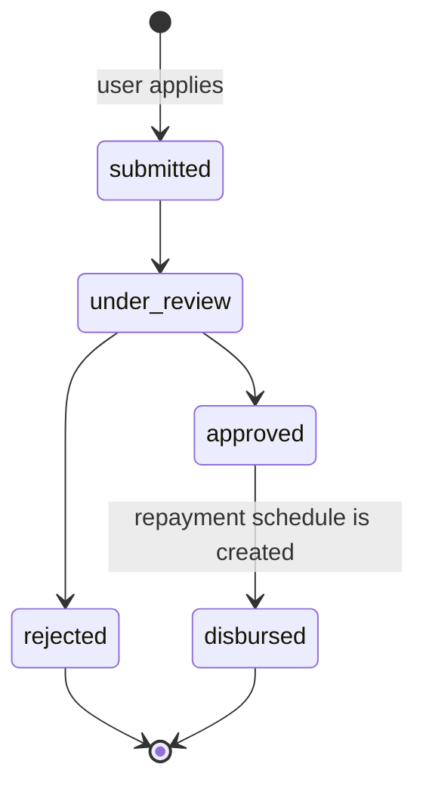

# Loan Calculator — Backend

Node.js + Express + MongoDB API for the Loan Application mobile app.

## Requirements

- Node.js 18+
- MongoDB: a local server, or a MongoDB Atlas connection string

## Setup

```bash
cd backend
npm install
cp .env.example .env
# edit .env and set a real MONGO_URI plus long random JWT and admin keys
```

## Run

```bash
npm run dev    # development (nodemon)
npm start      # production
npm test       # Jest + Supertest (see "Testing")
npm run lint   # ESLint
```

The API listens on `http://localhost:5000` by default. `GET /api/health` returns
`{ "status": "ok", "uptime": ..., "timestamp": ... }`.

Every API call is also available as a Postman collection:
[`docs/loan-calc.postman_collection.json`](docs/loan-calc.postman_collection.json).
Import it, run **Auth -> Send OTP** then **Verify OTP**, and the access token,
refresh token and loan id are saved into collection variables automatically.

## Environment variables

Copy `.env.example` to `.env`. Configuration is validated at startup, so a
missing or malformed value stops the server with a clear message.

| Variable                        | Default       | Purpose                                                      |
| ------------------------------- | ------------- | ------------------------------------------------------------ |
| `NODE_ENV`                      | `development` | `development`, `test` or `production`                        |
| `PORT`                          | `5000`        | HTTP port                                                    |
| `MONGO_URI`                     | required      | `mongodb://...` or `mongodb+srv://...` (include the DB name) |
| `CORS_ORIGIN`                   | `*`           | Comma separated allowed origins, or `*`                      |
| `ADMIN_API_KEY`                 | none          | 16+ chars, sent as `x-admin-api-key`. Required in production |
| `JWT_ACCESS_SECRET`             | required      | 32+ random characters                                        |
| `JWT_ACCESS_EXPIRES_IN`         | `15m`         | Access token lifetime                                        |
| `JWT_REFRESH_SECRET`            | required      | 32+ random characters, different from the access secret      |
| `JWT_REFRESH_EXPIRES_IN`        | `7d`          | Refresh token lifetime                                       |
| `OTP_MODE`                      | `console`     | `demo`, `console` or `sms` (see OTP modes)                   |
| `OTP_SMS_PROVIDER`              | `msg91`       | `fast2sms` or `msg91`, used only when `OTP_MODE=sms`         |
| `OTP_EXPIRES_IN_MINUTES`        | `5`           | OTP validity (whole minutes)                                 |
| `OTP_RESEND_COOLDOWN_SECONDS`   | `30`          | Minimum gap between OTP requests for one number              |
| `OTP_MAX_ATTEMPTS`              | `3`           | Wrong guesses before the OTP is thrown away                  |
| `RATE_LIMIT_WINDOW_MS`          | `900000`      | General API rate-limit window                                |
| `RATE_LIMIT_MAX`                | `100`         | Requests per window per IP                                   |
| `SEND_OTP_RATE_LIMIT_WINDOW_MS` | `900000`      | Window for the stricter send-OTP limiter                     |
| `SEND_OTP_RATE_LIMIT_MAX`       | `5`           | send-OTP requests per window per IP                          |

Never commit `.env` (it is git-ignored). `.env.example` holds placeholders only.

## Auth API

| Method | Endpoint               | Auth                | Body                                  |
| ------ | ---------------------- | ------------------- | ------------------------------------- |
| POST   | `/api/auth/send-otp`   | No                  | `{ "phone": "9876543210" }`           |
| POST   | `/api/auth/verify-otp` | No                  | `{ "phone": "...", "otp": "123456" }` |
| POST   | `/api/auth/refresh`    | No                  | `{ "refreshToken": "..." }`           |
| POST   | `/api/auth/logout`     | Bearer access token | none                                  |

`send-otp` accepts 10 digit Indian numbers starting with 6-9, with an optional `+91`.
OTP rules: 5 minute expiry, 30 second resend cooldown, 3 wrong attempts max.
The same hashing, expiry, attempt limit and rate limiting apply in every mode.

### OTP modes

`OTP_MODE` selects how OTPs are delivered:

- `demo`: the OTP is always `123456` and no SMS is sent. Intended for local app
  testing. Rejected at startup when `NODE_ENV=production`.
- `console`: a random OTP is generated and printed in the server logs only.
  The API never returns the OTP.
- `sms`: a random OTP is sent through the configured SMS provider
  (`OTP_SMS_PROVIDER=fast2sms` or `msg91`) using the `OtpSender` interface.

In production use `OTP_MODE=sms`. The SMS senders are placeholders: add provider
credentials to `.env` and implement `src/services/otp/smsOtpSender.js`. The auth
service does not change because every sender follows the `OtpSender` contract.

### Try it with curl

Successful responses use `{ "success": true, "message": "...", "data": ... }`.

`send-otp` returns:

```json
{ "phone": "9876543210", "expiresInSeconds": 300, "resendAfterSeconds": 30, "provider": "demo" }
```

`verify-otp` creates the user on first login and returns the session:

```json
{
  "accessToken": "<jwt>",
  "refreshToken": "<jwt>",
  "isNewUser": true,
  "profileCompleted": false,
  "user": { "_id": "...", "phone": "9876543210", "profileCompleted": false, "creditScore": 650 }
}
```

`refresh` returns a new `{ accessToken, refreshToken }`. The old refresh token
stops working immediately (rotation), and `logout` revokes the current one.

Common failures:

| Case                       | Status | Message                                              |
| -------------------------- | ------ | ---------------------------------------------------- |
| Invalid phone              | 422    | `Validation failed` + `errors: [{ field: "phone" }]` |
| OTP requested too soon     | 429    | `Please wait N seconds before requesting a new OTP`  |
| Wrong OTP                  | 400    | `Invalid OTP` + `attemptsRemaining` in `errors`      |
| Attempts used up           | 400    | `Too many wrong attempts. Please request a new OTP.` |
| Expired OTP                | 400    | `OTP has expired. Please request a new one.`         |
| Expired access token       | 401    | `Authentication token expired`                       |
| Rotated or revoked refresh | 401    | `Invalid authentication token`                       |

```bash
# 1. Send OTP (OTP_MODE=demo always uses 123456)
curl -X POST http://localhost:5000/api/auth/send-otp \
  -H "Content-Type: application/json" \
  -d '{"phone":"9876543210"}'

# 2. Verify OTP -> accessToken + refreshToken
curl -X POST http://localhost:5000/api/auth/verify-otp \
  -H "Content-Type: application/json" \
  -d '{"phone":"9876543210","otp":"123456"}'

# 3. Refresh (rotates both tokens)
curl -X POST http://localhost:5000/api/auth/refresh \
  -H "Content-Type: application/json" \
  -d '{"refreshToken":"<refreshToken>"}'

# 4. Logout (revokes the refresh token)
curl -X POST http://localhost:5000/api/auth/logout \
  -H "Authorization: Bearer <accessToken>"
```

## Users API

All endpoints require `Authorization: Bearer <accessToken>`.

| Method | Endpoint                     | Body                         |
| ------ | ---------------------------- | ---------------------------- |
| GET    | `/api/users/me`              | none                         |
| PUT    | `/api/users/me`              | any subset of profile fields |
| GET    | `/api/users/me/credit-score` | none                         |

Profile fields: `fullName`, `dob` (ISO date), `gender` (`male|female|other`),
`pan` (format `ABCDE1234F`, uppercased automatically), `email`, `monthlyIncome`
(> 0), `employmentType` (`salaried|self-employed`), `city`.

`profileCompleted` becomes `true` once every field above is present. PAN must be
unique (a duplicate returns `409`). The response never includes
`refreshTokenHash` or `fcmTokens` (`fcmTokens` is reserved for push
notifications, which are not built yet).

`GET /api/users/me` and `PUT /api/users/me` both return `{ "user": { ... } }`:

```json
{
  "user": {
    "_id": "...",
    "phone": "9876543210",
    "fullName": "Asha Verma",
    "dob": "1994-05-10T00:00:00.000Z",
    "gender": "female",
    "pan": "ABCDE1234F",
    "email": "asha@example.com",
    "monthlyIncome": 60000,
    "employmentType": "salaried",
    "city": "Pune",
    "profileCompleted": true,
    "creditScore": 650
  }
}
```

```bash
curl http://localhost:5000/api/users/me \
  -H "Authorization: Bearer <accessToken>"

curl -X PUT http://localhost:5000/api/users/me \
  -H "Authorization: Bearer <accessToken>" \
  -H "Content-Type: application/json" \
  -d '{
    "fullName": "Aryan Kumar",
    "dob": "2000-01-15",
    "gender": "male",
    "pan": "ABCDE1234F",
    "email": "aryan@example.com",
    "monthlyIncome": 50000,
    "employmentType": "salaried",
    "city": "Delhi"
  }'
```

## Loans API

| Method | Endpoint                                           | Auth                | Body                                                                     |
| ------ | -------------------------------------------------- | ------------------- | ------------------------------------------------------------------------ |
| POST   | `/api/loans/calculate`                             | No                  | `{ "amount": 100000, "tenureMonths": 12 }`                               |
| POST   | `/api/loans/eligibility`                           | Bearer access token | `{ "amount": 100000, "tenureMonths": 12 }`                               |
| POST   | `/api/loans/apply`                                 | Bearer access token | `{ "amount": 100000, "tenureMonths": 12, "purpose": "Home renovation" }` |
| GET    | `/api/loans?page=1&limit=10`                       | Bearer access token | none                                                                     |
| GET    | `/api/loans/:id`                                   | Bearer access token | none                                                                     |
| GET    | `/api/loans/:id/repayments`                        | Bearer access token | none                                                                     |
| POST   | `/api/loans/:id/repayments/:installmentNumber/pay` | Bearer access token | none                                                                     |

`calculate` is public: it only depends on the amount and tenure, returns no
personal data, and lets a user explore EMIs before creating an account.
`eligibility`, `apply` and the retrieval endpoints are authenticated because
they use the signed-in user's profile or applications.

```bash
curl -X POST http://localhost:5000/api/loans/calculate \
  -H "Content-Type: application/json" \
  -d '{"amount":100000,"tenureMonths":12}'

curl -X POST http://localhost:5000/api/loans/eligibility \
  -H "Authorization: Bearer <accessToken>" \
  -H "Content-Type: application/json" \
  -d '{"amount":100000,"tenureMonths":12}'
```

The calculator responds with:

```json
{
  "emi": 8884.88,
  "totalPayable": 106618.56,
  "totalInterest": 6618.56,
  "interestRate": 12
}
```

The eligibility response always has the same shape. `reasons` is empty only
when `eligible` is `true`:

```json
{
  "eligible": false,
  "maxEligibleAmount": 400000,
  "reasons": [
    "The maximum loan amount you are eligible for is ₹4,00,000, but you requested ₹4,50,000."
  ]
}
```

### Applications

Submitting an application re-runs the eligibility service on the server using
the stored profile. The client cannot skip or override any rule. The saved
application records the server-calculated rate, EMI and total payable.

```bash
# Submit an application
curl -X POST http://localhost:5000/api/loans/apply \
  -H "Authorization: Bearer <accessToken>" \
  -H "Content-Type: application/json" \
  -d '{"amount":100000,"tenureMonths":12,"purpose":"Home renovation"}'

# My applications, newest first
curl "http://localhost:5000/api/loans?page=1&limit=10" \
  -H "Authorization: Bearer <accessToken>"

# One application, including its status history
curl http://localhost:5000/api/loans/<applicationId> \
  -H "Authorization: Bearer <accessToken>"
```

A successful application returns `201` with a readable number such as
`LN-2026-000123`, the quote snapshot, `status: "submitted"` and the first
`statusHistory` entry. The list response includes
`pagination: { page, limit, total, totalPages }`.

```json
{
  "application": {
    "_id": "...",
    "applicationNumber": "LN-2026-000123",
    "amount": 100000,
    "tenureMonths": 12,
    "interestRate": 12,
    "emi": 8884.88,
    "totalPayable": 106618.56,
    "purpose": "Home renovation",
    "status": "submitted",
    "rejectionReason": null,
    "statusHistory": [
      { "status": "submitted", "note": "Application submitted", "changedAt": "..." }
    ]
  }
}
```

An ineligible applicant gets `422` with `You are not eligible for this loan` and
the same `reasons` the eligibility endpoint returns. An incomplete profile gets
`422` with `Complete your profile before applying for a loan`. Another user's
application id returns `404`.

**Duplicate active applications:** one user can have only one application in
`submitted` or `under_review`. A second request is rejected with `409` and the
existing application number. This avoids accidental double applications and
duplicate credit checks while an application is still being processed.
`approved`, `rejected` and `disbursed` are terminal for this rule, so a new
application is allowed after the previous one leaves the active states. The
service check gives the readable message; a partial unique index on the Loan
collection also prevents two concurrent requests from both creating an active
application.

### Repayments

When a loan moves to `disbursed`, the server creates one repayment row per EMI.
Installment 1 is due one month after disbursement, and each later installment is
due on the same day of the following months. Amounts use the stored `emi`.

Payments are simulated (no payment gateway). Only the loan owner can pay, and
only once per installment. Installments must be paid **in order**: paying
installment 3 while 2 is unpaid returns `409 Please pay installment 2 first`,
which matches the app, where only the next installment can be paid. A payment
made after `dueDate` is stored as `late`; otherwise it is stored as `paid`. Both
set `paidAt`.

Paying returns the updated row and the new score, so the app can refresh both:

```json
{
  "repayment": { "installmentNumber": 1, "status": "paid", "paidAt": "...", "amount": 8884.88 },
  "creditScore": { "score": 660, "band": "fair" }
}
```

```bash
# Full repayment schedule with current statuses
curl http://localhost:5000/api/loans/<loanId>/repayments \
  -H "Authorization: Bearer <accessToken>"

# Simulate paying installment 1
curl -X POST http://localhost:5000/api/loans/<loanId>/repayments/1/pay \
  -H "Authorization: Bearer <accessToken>"
```

Repayments are available only after disbursement; before that both repayment
endpoints return `409`. Unpaid installments remain `pending`; an overdue but
unpaid installment is not changed until it is paid.

## Admin API

These endpoints are a demo stand-in for an admin console. Instead of admin user
accounts, they require the shared `ADMIN_API_KEY` in the `x-admin-api-key`
header. This is intentionally simple and must be replaced with real admin
accounts and roles before launch. If the key is not configured, the admin API
returns `503`; production refuses to start without it.

| Method | Endpoint                             | Body                                 |
| ------ | ------------------------------------ | ------------------------------------ |
| PATCH  | `/api/admin/loans/:id/status`        | `{ "status": "...", "note": "..." }` |
| POST   | `/api/admin/loans/:id/auto-decision` | none                                 |

```bash
# Move an application through an allowed transition
curl -X PATCH http://localhost:5000/api/admin/loans/<loanId>/status \
  -H "x-admin-api-key: $ADMIN_API_KEY" \
  -H "Content-Type: application/json" \
  -d '{"status":"under_review","note":"Picked up for review"}'

# Run the basic approval decision (only from under_review)
curl -X POST http://localhost:5000/api/admin/loans/<loanId>/auto-decision \
  -H "x-admin-api-key: $ADMIN_API_KEY"
```

The status state machine (defined once in `src/services/loanWorkflow.service.js`)
allows only these moves:



`rejected` and `disbursed` are final. Any other transition returns `409` with a
message such as `Invalid loan status transition: submitted -> approved`, and an
unknown status returns `422`. The state machine is a single map, so the admin
API, `auto-decision` and the simulator can't disagree about what is allowed.

Admin responses return the application under a `loan` key (the user-facing
endpoints use `application`).

`auto-decision` reloads the applicant, re-runs eligibility against the current
profile (including the credit-score rule), and moves `under_review` to
`approved` or `rejected`. Rejections store the generated explanation in both
`statusHistory` and `rejectionReason`.

Every transition appends to `statusHistory` and emits the internal
`loan.status.changed` event from `src/events/loanEvents.js` with
`{ loan, previousStatus, newStatus, note }`. No notifications are sent yet; the
notification module will subscribe to this event later.

### Demo the status flow

```bash
npm run simulate:loan -- <loanId>
SIMULATION_DELAY_MS=500 npm run simulate:loan -- <loanId>
```

The helper is development-only (it refuses to run when `NODE_ENV=production`).
Starting from the loan's current status, it waits between steps and walks the
application through `under_review -> approved -> disbursed`.

## Loan Rules

All numbers and limits live in `src/constants/loanRules.js`, so the calculator,
eligibility check and request validation cannot drift apart.

### Calculator

- **Amount:** ₹10,000 to ₹5,00,000 (whole rupees).
- **Tenure:** 3 to 60 months.
- **Interest rate:** a flat **12% p.a.**, converted to a monthly rate of
  `12 / 12 / 100 = 0.01`. A credit-score-based rate was intentionally not used
  here: the public calculator has no credit profile to read, and one fixed rate
  keeps the estimate deterministic and easy to explain. Eligibility uses the
  same rate, so the quoted EMI and the eligibility decision always agree. If
  credit-band pricing is added later, only this constant changes.
- **EMI:** standard reducing-balance formula

  ```
  EMI = P * r * (1 + r)^n / ((1 + r)^n - 1)
  ```

  where `P` is the principal, `r` is the monthly rate and `n` is the tenure in
  months.

- **Totals:** `totalPayable = EMI * tenureMonths` and
  `totalInterest = totalPayable - amount`, all rounded to 2 decimal places.
  Total payable uses the rounded EMI, so the returned numbers add up exactly.

### Eligibility

The check returns `eligible`, `maxEligibleAmount` and a `reasons` array. Every
failed rule adds one plain-language reason; the app can display the array as-is.

| Rule                    | Requirement                                                            |
| ----------------------- | ---------------------------------------------------------------------- |
| Profile completed       | `profileCompleted` must be `true`.                                     |
| Valid PAN               | PAN must be present and match `ABCDE1234F`.                            |
| Age                     | Between 21 and 60 years inclusive (calculated from `dob`).             |
| Minimum income          | Monthly income of at least ₹15,000.                                    |
| Credit score            | At least 600.                                                          |
| FOIR                    | EMI must be at most 50% of monthly income.                             |
| Maximum eligible amount | `min(10 x monthly income, ₹5,00,000)`; the request cannot exceed this. |

FOIR means Fixed Obligation to Income Ratio: the part of monthly income that
would go towards the EMI. Above 50%, the loan is treated as unaffordable.
`maxEligibleAmount` is a profile-level cap based on income. A specific amount
can still fail the FOIR rule, especially over a short tenure, even when it is
below the cap.

### Applications

Statuses follow the lifecycle `submitted -> under_review -> approved/rejected ->
disbursed`. Applications start as `submitted` with a matching first entry in
`statusHistory`. Application numbers use a yearly atomic counter, formatted as
`LN-<year>-<six-digit sequence>`.

Only one application may be in `submitted` or `under_review` at a time; see the
duplicate rule above.

## Credit Score

Every user starts at **650** and stays within **300–900**. All values live in
`src/constants/creditScoreRules.js`.

| Event                         | Change |
| ----------------------------- | ------ |
| On-time repayment             | +10    |
| Late repayment                | −20    |
| All installments paid (bonus) | +30    |

Changes are applied immediately when a repayment is recorded. The new score is
clamped to the allowed range, and the audit log stores the change that was
actually applied, so the log always sums to the current score. The bonus is
added once per loan after the last unpaid installment is paid.

| Band      | Score   |
| --------- | ------- |
| Poor      | 300–599 |
| Fair      | 600–699 |
| Good      | 700–799 |
| Excellent | 800–900 |

```bash
# Current score, band and the 10 most recent changes
curl http://localhost:5000/api/users/me/credit-score \
  -H "Authorization: Bearer <accessToken>"
```

The response contains `score`, `band` and `recentChanges` (newest first, up to
10 entries with `change`, `previousScore`, `score`, `reason` and `createdAt`).
Each change is stored in the `CreditScoreLog` collection for auditing. The score
is also returned by the existing `/api/users/me` endpoint.

## Testing

```bash
npm test
```

The tests need a MongoDB. By default they use `mongodb://127.0.0.1:27017/loan_calc_test`.
To run them against a remote database such as Atlas, set `TEST_MONGO_URI`:

```bash
TEST_MONGO_URI="mongodb+srv://<user>:<password>@<cluster>/loan_calc_test" \
  npm test -- --testTimeout=30000
```

The tests delete data from their collections, so `tests/setupEnv.js` refuses any
database whose name does not end in `_test`. A remote database is slower than a
local one, hence the larger timeout.

## Structure

```
src/
  config/       env validation + MongoDB connection
  constants/    HTTP status codes, shared messages, loan, repayment and credit rules
  controllers/  request/response handling only
  events/       internal EventEmitter for loan status changes
  middlewares/  auth, admin API key, validation, rate limiting, errors
  models/       Mongoose schemas (User, Otp, Loan, Counter, Repayment, CreditScoreLog)
  routes/       Express routers
  services/     business logic (auth, OTP, EMI, eligibility, workflow, repayment, credit)
  utils/        AppError, asyncHandler, tokens, phone, date, PAN and OTP helpers
  validators/   Joi request schemas
  app.js        Express app
  server.js     starts server + DB connection
```

## Response format

Success:

```json
{ "success": true, "message": "...", "data": {} }
```

Error:

```json
{ "success": false, "message": "...", "errors": [] }
```
